<table>
<tr>
<td valign="top"></td>
<td valign="top"></td>
</tr>
</table>

## n1th1n

<picture>
  <source media="(prefers-color-scheme: light)" srcset="./tagline-light.svg" />
  
</picture>

[![Website](https://img.shields.io/badge/daystack.space-0d1117?style=for-the-badge&logo=data%3Aimage%2Fpng%3Bbase64%2CiVBORw0KGgoAAAANSUhEUgAAAGQAAABkCAYAAABw4pVUAAAGcElEQVR4AeybXWxURRTHz0xLl25BQcBHhbZogltUMBEVxRdeSoAHDSQqmJhYnkyAaqK0mhpbfKFFE19aY6IlfiYahVB9MEFrxETxg35oYum2vFqKtLS72cLe45k2TQnFy%2FTOnd3Zu2czZ%2Fey986Z%2F%2Fn%2Fdm6700ECP5xygIE4hQOAgTAQxxxwTA7PEAbimAOOyeEZwkAcc8AxOTxDGIhjDjgmx84McazIQpLDQByjxUAYiGMOOCaHZ0ixAqnqH6uu7vl355q%2B0eerekbrCiGUVqW5uvdSVa64WZ8hq8%2BObqrqvfgTetkBT%2BCXAkUHCtFeCKG0Ks0eeOfW9F48vbr%2FwoO2wVgFQp%2BwJ6UU3yPAJtuF2M4vAB6Snuyu7Bt9wuZY1oCsOTtyN33COkl8GUVUWhmg6Kz8c2ytrYKsARGypJFEl1NErcUxm1W1WanLDhBElXdHyIqdSUe3rx2ASC%2FhS1LGhZ61qmdiJSW9hSKqbRnVuMpGcVaAZL2rcRtiXcppq0YrQFwyrtC0MBDHiDEQBuKYA47J4RlSDEBKZGnKsTpDl2OrRiszZHD9kgvkwBhFVNslqnHERnFWgIAQHn2NPW5DcOg5AyRExK%2BoRlozDdD5Jl3sAKFBab2nmV7SFFFrKVlSqmqzUpc1IMn7Vv0NAveQ6gxFVBrVIvYM3nPrOVsFWQOiBCcTKz5H4T1Gx6cpCr39CMJ7NFmz%2FAubhVgFooQPJVb%2BnKy57ZESlFUoxE4UWCcQ9xVCKK1Kc9aTlVTD5mRi5S%2BqJpthHcis%2BIH1y5JDieXHhxIr3h1cv6KjEEJpVZrP37tsaLYO2685A2K7kKjkZyCOkWQgDMQxBxyTE2yGnBpavPjr3scXnezds6irr47jGg%2FIk9Kuni1AHgVhvTAgXQOxsq7%2BlrL05IiH4pQQopOWSNo5YM4D8kSC%2FI48%2Boe8agbybCFg9IGcOBOPQeZbADxEAyyh4ObvwFLyqmHaM%2FLO%2F9K5s9pAykpi79Bq2ua5rnyk44DyLFa6%2BG2da9U1WkBiJ%2F%2B6C0A8C%2FwI5AAiPBf7pr9ap7MWEFrD2U7J9K6lC7nNc0ACovJw3onr39A1OWfb8a8XGJl%2FexDeDKE%2FyERxj25OWdPPEq3Ng7ozJKfii3kwBuIYfQZSSEAc01oUcniGOIZZCwitWUVx90hOUQgArc2DWkDoS421XRY5dSWfg0nQ8lAPiCdPUC0eBbdADogsfai1Ng5qAclsXzcAIN4HfgRyQAC%2Bl6mtGdTprAVEJZrKpl8QCD%2BoYw59BwhGd2ZifL9uD20gsP2BVEbEtlLiNyguU3Dzd2CcblOvZybEVtj1sPYvRfpA1OC1azNTtYnXpiC2ykO5hda49tIazT4OmPMAca%2Fyhjy6fWpbTRPsSkwp63RjYUBmsxKYq9vWdV%2FZVnPsSm2ig%2BMaD8gT5Q2QR7N2LeQ1GJCFjDDvWn7DzwEG4udOHs4xkDyY7jckA%2FFzJw%2FnwgXS1CTj9W9uLD%2FYvDte31wX5Sg%2F0LIrvr9lA1DNYXILDUjFwZa98fFFQ4DeGQHiE0DRHuUQAj4FCb9SzcmK%2BsPqf4qFwiUUIBUHWtrou8gHpOgOimJrd9L3sc7y%2BpYjYRRuDETNDBRwIAwxhZyDlpXqK%2BqbnzatwQwI3T9pZqilFFMdkeiPKJqB7tMmxRgBiV%2BO3U%2BDF%2BNtisq%2BYVsd339YeXLDkzpvGgFBz3NmA51Osbm4BiUaeWIERArQ2vyVCyNcGUOCqDDRIk06c9%2FwHWAg4XtqlJGBGNkXfmcGEr6nRhkZiJF94Xc2AuKh3uav8GW7m9EDnDRRZwRESKm1tcVEYKH1FVCitSEO%2FudhBCS1NPM75T1PwW3GgeFU28t%2FzBwGezYCQn8L8IQQrwYbuhB6LUwjLTA2ANAzBH%2BYAaFxJ1sPHaPV3lY6LOqGgEcmjzZ8ZGqCMRAlIN3a8KIQ%2BAwdD1MUWxtGgU%2Bl2xpfCqPwUIAoIZOtjR%2Bm2g5VggcbEWE3zdx9UY7pGkFuUDWnWxs%2FVh6EEaEBmREjMPVWw2%2Fpow2fpVobO6Ic0zW2vUK%2F1Jj9zJjxbe45ZCBzifkomAMMJJhv1noxEGvWBkvMQIL5Zq0XA7FmbbDEDCSYb0a9%2FDozED938nCOgeTBdL8hGYifO3k4x0DyYLrfkAzEz508nGMgeTDdb0gG4udOHs4xkDyY7jfkfwAAAP%2F%2FXc6zqAAAAAZJREFUAwAPF%2B4ULU%2FE0gAAAABJRU5ErkJggg%3D%3D)](https://daystack.space)

 

### Projects

<!-- cards refresh daily; each links to its repo -->
<table>
<tr>
<td></td>
<td></td>
</tr>
<tr>
<td></td>
<td></td>
</tr>
<tr>
<td></td>
<td></td>
</tr>
</table>

### Latest releases

<!-- releases:start -->

| Project | Release | Date |
| :--- | :--- | :--- |
| [duck-share](https://github.com/n1th1n-19/duck-share) | [v1.18.2-duck.5](https://github.com/n1th1n-19/duck-share/releases/tag/v1.18.2-duck.5) | 2026-10-27 |
| [Forge](https://github.com/n1th1n-19/Forge) | [v0.3.0](https://github.com/n1th1n-19/Forge/releases/tag/v0.3.0) | 2026-10-24 |
| [designed](https://github.com/n1th1n-19/designed) | [v0.1.2](https://github.com/n1th1n-19/designed/releases/tag/v0.1.2) | 2026-10-23 |
| [RTMON](https://github.com/n1th1n-19/RTMON) | [v1.1.0](https://github.com/n1th1n-19/RTMON/releases/tag/v1.1.0) | 2026-10-20 |
| [Tag-Team](https://github.com/n1th1n-19/Tag-Team) | [v0.4.6](https://github.com/n1th1n-19/Tag-Team/releases/tag/v0.4.6) | 2026-10-16 |

<!-- releases:end -->

 

<!-- refreshed daily by the workflow -->

  

<!-- animated contribution graph, refreshed daily by the workflow -->

 

<b>Now building</b>

 

**Forge** detects your OS and distro, shows a checklist of tools, and installs only what you select.

**Tag-Team** runs work and personal Claude accounts as a tag team, with usage life bars and a token heatmap.

**duck-share** adds NFC tap-to-share to LocalSend on Android.

